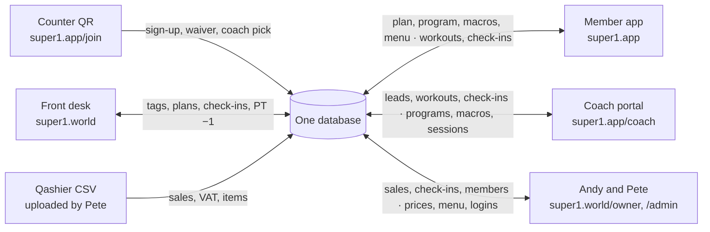
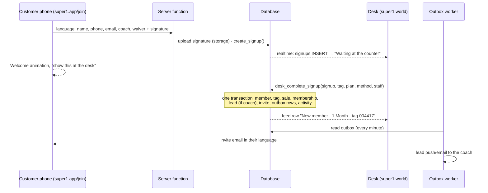
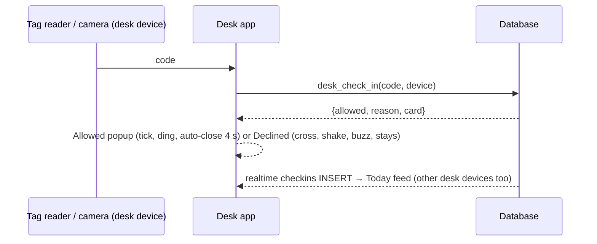
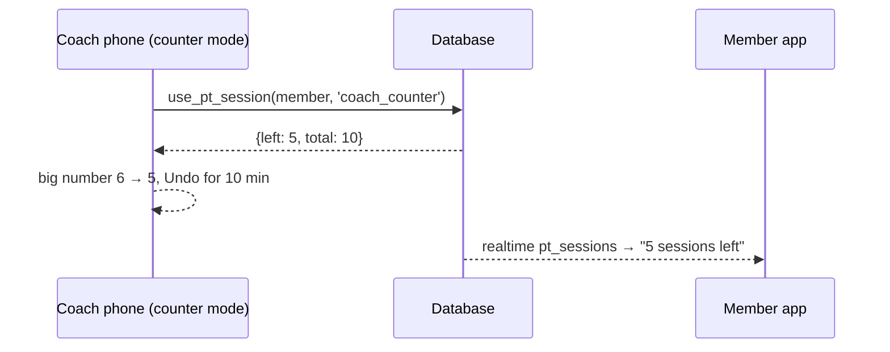
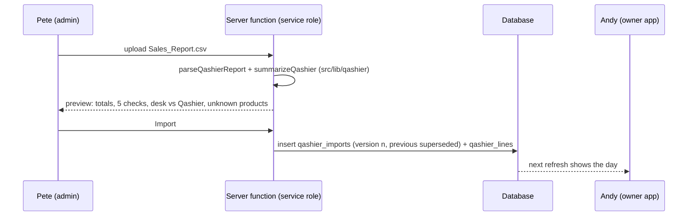

# 02 · Connections

Six surfaces, one database. Nothing talks to anything else directly: every surface reads and writes the same member record, and live screens subscribe to the tables they care about. The mock-up's **Connections** board shows the same picture.

## The 11 flows

| # | When this happens | It writes | Who sees it, and where |
|---|---|---|---|
| 1 | A customer scans the counter QR and signs up | `signups` (+ signature in storage) | Desk: appears in **Waiting at the counter** instantly (realtime) |
| 2 | The desk scans a tag and sells the plan (paid on Qashier) | `members`, `credentials`, `sales`, `memberships`, `leads`, `invites`, `outbox`, `activity` (staff on shift) | Member: app invite email · Coach: new lead if picked · Andy: count |
| 3 | An existing member links their tag and email | `signups` (kind `link`) → `members.email`, invite | Member: invite. Desk confirms first if the email doesn't match |
| 4 | A member scans in at the door | `checkins` (allowed or declined), one visit used on packs | Desk feed · Member app: visits · Andy: live pulse |
| 5 | A coach or the desk logs a PT session | `pt_sessions`, pack goes 6 → 5 | Member app: sessions left · Coach portal: client card · Desk feed |
| 6 | A coach sends a program, macros or café picks | `program_versions`, `nutrition_targets`, `coach_picks`, `coach_notes` | Member app: Train and Fuel update live, with a notification |
| 7 | A member logs a workout or a daily check-in | `workout_logs`, `set_logs`, `daily_checkins` | Coach portal: client tabs · Member app: progress and PRs |
| 8 | Pete changes a price, a café item or a login | `plans` (+ `plan_price_history`), `menu_*`, `profiles` | Desk sell sheet · Member app menu · who can open what |
| 9 | Pete uploads the day's Qashier CSV | `qashier_imports`, `qashier_lines` | Andy: sales. Flags if Qashier and the desk disagree on memberships sold |
| 10 | The desk messages Pete or asks for a merge | `messages`, `merge_requests`, `outbox` (email) | Pete's inbox; his reply or the merge shows at the desk |
| 11 | Later: a member pays online in the app | `payments` → `sales` + `memberships` | Desk, Andy. Also rung into Qashier so VAT stays in one place |

## Flow 1 + 2: counter QR to member

## Flow 4: the door

- Hardware: USB/Bluetooth tag readers type the code and press Enter. The check-in screen keeps a hidden input focused, so a scan works from anywhere on the check-in page. The member app QR is a second credential (`kind = qr`) for when a tag is forgotten.
- Offline: if the network drops, the desk shows "Offline: scans are queued" and replays them in order when back (store in IndexedDB). Never decide offline; show "Can't check" instead of allowing.

## Flow 5: PT −1 from the coach's phone

## Flow 9: Qashier import and reconciliation

Reconciliation compares, for the same business date:

- desk `sales` grouped by plan → `plans.qashier_product` (and `qashier_modifier` for PT and InBody)
- Qashier product lines in the gym categories

A difference means something was sold but not rung, or rung but not logged. Show both numbers and the difference; don't auto-correct.

## Live updates (realtime)

| Screen | Subscribes to | Shows |
|---|---|---|
| Desk check-in | `signups` (waiting), `checkins` (today) | Counter queue, Today feed, badge count |
| Desk sidebar | `messages` | Unread replies from Pete |
| Coach portal | `leads` (own), `pt_sessions` (own), `daily_checkins` + `workout_logs` (own clients) | New lead slides in; client cards update |
| Member app | `program_versions`, `nutrition_targets`, `coach_notes`, `coach_picks`, `pt_sessions` (self) | "Sunman sent your program", sessions left |
| Pete | `merge_requests`, `messages` | Inbox |
| Andy | `checkins` (today) | Live pulse (last hour) |

RLS applies to realtime, so each subscriber only receives rows it may read.

## Outbox events (sent by the worker)

| Kind | Sent to | Content |
|---|---|---|
| `invite_email` | New member | SUPER1 app invite in their language (EN/TH/RU), sign-in link |
| `lead_push` | Coach | "New lead: Ivan Petrov picked you at the counter" (email now, push later) |
| `program_push` | Member | "Sunman sent your program" (email/push) |
| `merge_request_email` | Pete | Merge request with both member numbers |
| `support_email` | Pete | Desk message (replaces the old staff email function) |
| `renewal_reminder` | Member | 7 and 1 days before the end; win-back 3 days after (nightly job) |

The worker runs every minute (Cloudflare Cron Trigger), sends, and stamps `sent_at`. Failures increment `attempts` and keep `last_error`; nothing is sent twice.
