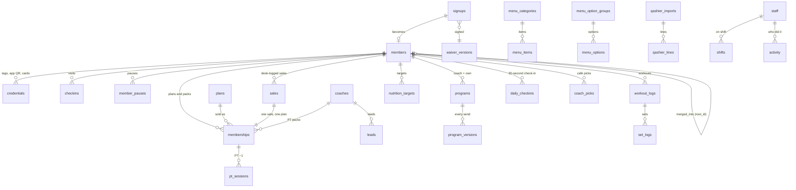

# 03 · Data model

One Supabase Postgres database serves every app. The schema is `supabase/migrations/0001_init.sql`; it is tested on plain Postgres by `npm run db:test` (61 checks). Read this page for the shape, the SQL for the detail.

## The shape

## Tables

| Area | Table | What it holds | Written by |
|---|---|---|---|
| People | `profiles` | One per login: role `admin`, `owner`, `desk`, `coach`, `member` | Pete (invites) |
| | `staff` | Desk names on the shift picker, Qashier login name | Pete |
| | `coaches` | Coaches, photo, on the QR or not, portal status, Qashier product | Pete |
| | `desk_devices`, `shifts` | Desk iPad/laptop, who's on shift | Desk |
| Members | `members` | Person, member number (from 1001), contact, language, app login link, archive and merge fields, `root_id` | Desk, QR sign-up |
| | `credentials` | Tag numbers, app QR codes, old Glofox cards (`code` is unique and normalised) | Desk |
| | `member_pauses` | Pauses (from, until, original until) | Desk |
| Plans | `plans` | What can be sold: price, length, sessions, desk on/off, Qashier names | Pete |
| | `plan_price_history` | Every price change | Pete |
| | `sales` | What the desk logged as sold (mirror of Qashier) | Desk |
| | `memberships` | Each plan a member bought: dates (inclusive), sessions, coach | Desk (`desk_sell`) |
| Door | `checkins` | Every scan or manual check-in, allowed or declined, with reason | Desk (`desk_check_in`) |
| PT | `pt_sessions` | Each session taken off a pack; undo marks it | Desk, coach |
| Sign-up | `waiver_versions` | Waiver lines in EN/TH/RU, versioned | Pete |
| | `signups` | Counter QR submissions, waiting → completed | Customer, desk |
| | `leads` | Coach leads and their stage | Desk, coach |
| | `invites` | App invites sent to members | Desk |
| Coaching | `exercises` | SUPER1 library (107) + each coach's own | Seed, coach |
| | `programs`, `program_versions` | A program per member per coach (and the member's own); every send is a new version | Coach, member |
| | `nutrition_targets` | Goal, P/C/F grams, kcal (computed), water, steps; every send is a new row | Coach |
| | `coach_notes`, `coach_picks` | Notes on the member's Home; café items pinned on their Fuel tab | Coach |
| | `workout_logs`, `set_logs` | What the member did, set by set | Member |
| | `daily_checkins` | Sleep, energy, digestion, water, steps, weight, note (one per day) | Member |
| Café | `menu_categories`, `menu_items`, `menu_option_groups`, `menu_options` | The menu in the member app, prices incl. VAT, macros (shown only once verified), Qashier names | Pete |
| | `cafe_orders` | "Show at the counter" cards from the app (not payments) | Member |
| Qashier | `qashier_imports`, `qashier_lines`, view `qashier_days` | Each imported daily report (versioned) and its lines | Pete (server, service role) |
| Ops | `activity` | Audit trail: what, member, staff, login, when | Every function |
| | `messages` | Desk ↔ Pete support chat | Desk, Pete |
| | `merge_requests` | Desk asks, Pete merges or rejects | Desk, Pete |
| | `outbox` | Emails and pushes to send, written inside the same transaction | Functions; sent by a worker |
| | `settings` | Gym details, rule numbers, languages | Pete |

## Identity and merges

- Every member has `root_id`. It is their own id unless they were merged into someone else, then it's the kept member's id.
- **Every read that means "this person" groups by `root_id`.** `member_card(member)` returns everything a screen needs for one person (status, days left, plan, PT left, visits left, visits this month) and already does this.
- `my_member_root()` gives a logged-in member their root, so the member app works the same after a merge.

## Functions the apps call (RPC)

| Function | Who | What |
|---|---|---|
| `desk_check_in(code, device, method, staff)` | Desk, Pete | Door decision + check-in row + popup data |
| `desk_sell(member, plan, method, staff, coach, price, note)` | Desk, Pete | Sale + membership with queued dates |
| `desk_day_pass(method, staff, qty)` | Desk | Walk-in day pass: sale + check-in |
| `desk_complete_signup(signup, tag, plan, method, staff)` | Desk | Member + tag + plan + lead + invite |
| `desk_complete_link(signup, staff, use_email)` | Desk | Existing member links tag + email from the QR, invite sent |
| `use_pt_session(member, via, staff)` / `undo_pt_session(session, staff)` | Desk, the pack's coach | PT −1 / undo within 10 min |
| `pause_member(member, from, until, staff, reason)` / `end_pause(pause, resume_on, staff)` | Desk, Pete | Pauses with the cascade |
| `archive_member` / `restore_member` | Desk, Pete | Archive, restore |
| `request_merge(keep, duplicate, staff, note)` | Desk | Ask Pete |
| `merge_members(request)` / `reject_merge` / `unmerge_member` | Pete | Merge as link |
| `member_card(member, today)` | Anyone allowed to see that member | Standing for one person |
| `join_options()` / `create_signup(json)` | Anyone (no login) | Counter QR |
| `coach_send_program(member, body)` / `coach_set_targets(...)` | The member's coach | New program version / new targets |

Plain table reads and simple writes (menu edits, leads stage, daily check-in, workout logs) go straight to the tables through RLS.

## Who can read what (RLS)

Default deny. ✓ = read · W = write (directly or through a function) · — = no access

| Data | Pete (admin) | Andy (owner) | Desk | Coach | Member | No login |
|---|---|---|---|---|---|---|
| Members, plans sold, check-ins | ✓ W | ✓ | ✓ W | own clients and leads | self | — |
| Tags and codes | ✓ W | — | ✓ W | — | self | — |
| Sales (desk log) | ✓ | ✓ | ✓ W | — | — | — |
| PT sessions | ✓ W | ✓ | ✓ W | own clients W | self | — |
| Sign-ups waiting | ✓ W | — | ✓ W | — | — | create only |
| Leads | ✓ W | ✓ | ✓ W | own W | — | — |
| Programs, targets, notes, picks | ✓ | — | — | own clients W | self (own program W) | — |
| Workouts, daily check-ins | ✓ | — | — | own clients | self W | — |
| Plans, prices | ✓ W | ✓ | ✓ | ✓ | ✓ | — |
| Café menu | ✓ W | ✓ | ✓ | ✓ | ✓ | ✓ (live items) |
| Qashier days and lines | ✓ W* | ✓ | — | — | — | — |
| Activity | ✓ | ✓ | ✓ | — | own plan and PT events | — |
| Desk ↔ Pete messages, merge requests | ✓ W | — | ✓ W | — | — | — |
| Staff list | ✓ W | ✓ | ✓ | — | — | — |
| Coaches | ✓ W | ✓ | ✓ | ✓ | ✓ | names on the QR |

\* Qashier imports are written by the server with the service role after Pete uploads a file.

Coaches see a member when that member (any member in the same merge group) has a PT pack with them or is their lead. A coach never sees sales or other coaches' clients.

## Conventions

- Primary keys `uuid` (`gen_random_uuid()`), except catalog tables with readable text ids (`plans.id = '1m'`, `menu_items.id = 'strong-vibes'`) and append-only logs (`bigint identity`).
- Timestamps `timestamptz`; business dates `date` in Bangkok time; money `integer` baht; Qashier money `numeric(12,2)`.
- Enum-like columns are `text` with `check` constraints (easier to extend than Postgres enums).
- Foreign keys never cascade deletes (there are no deletes).
- Every table has row level security on; `delete` and `truncate` are revoked from `anon` and `authenticated`.
- Realtime is on for: `signups`, `checkins`, `leads`, `pt_sessions`, `program_versions`, `nutrition_targets`, `coach_notes`, `coach_picks`, `messages`, `merge_requests`.

## Storage buckets

| Bucket | Public | Holds |
|---|---|---|
| `signatures` | no | Waiver signature PNGs, `signatures/<signup id>.png` (desk and Pete can read) |
| `menu` | yes | Menu photos (`menu/<file>`) |
| `coaches` | yes | Coach photos |
| `exercises` | yes | Exercise videos and stills (later) |
| `brand` | yes | Logos, QR stand poster |
