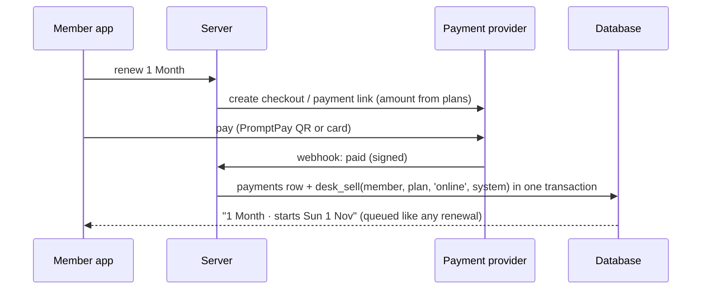

# 07 · Payments

**Decision for launch: SUPER1 takes no money.** Qashier stays the till and the tax record. The desk logs what was sold and how it was paid; Pete imports the Qashier report; SUPER1 checks the two agree. Online payment is a later phase (phase 7), built only if Andy wants members to renew from the app.

## Why not "run everything through Stripe"

On Mon 12 Oct the till took ฿50,222: **cash ฿23,688 (47%)**, PromptPay ฿14,341, cards ฿12,193. Moving the counter to Stripe would:

- put fees on money that today costs nothing (cash) or little (counter PromptPay);
- lose Qashier's VAT, product and staff reporting, which the accountant already uses;
- not remove Qashier anyway: the café needs a till with a cash drawer and modifiers.

Stripe Thailand standard pricing (stripe.com/th/pricing, checked 12 Oct 2026):

| Method | Fee | 1 Month ฿2,200 costs |
|---|---|---|
| PromptPay | 1.65% (+ ฿10 per refund) | ฿36.30 |
| Thai card | 3.65% + ฿10 | ฿90.30 |
| International card (most tourists) | 4.75% + ฿10 | ฿114.50 |
| Currency conversion | +2% | |

PromptPay through Stripe: Thailand Stripe accounts only, THB only, refunds need the customer's bank account, and **no automatic recurring charges** (Stripe subscriptions only support "send invoice", so the member pays each renewal by hand). Customers see "STRIPE PAYMENTS (THAILAND) LTD" in their bank app.

## Phase 7 options (when Andy wants app renewals)

1. **Ask Qashier first.** QashierPay Online offers pay-by-link and hosted checkout that it says sync into QashierPOS (one view of in-store and online sales). Its public page reads like the Singapore product and doesn't list PromptPay, so ask Qashier Thailand directly (+66 02 544 0267, LINE @qashier.th): does Pay-by-Link work for a Thai merchant, with PromptPay and cards, and do those sales land in the same daily report and VAT totals? If yes, this is the best fit: one till, one tax record.
2. **Otherwise Stripe** (PromptPay + cards) for app renewals only, with a webhook that creates the sale and membership, and the desk (or a daily job) rings the online total into Qashier as an "Online payments" tender so VAT stays in one place.

Either way, the flow in SUPER1 is the same:

Rules for phase 7: idempotent webhooks (store the provider event id, unique); never trust the amount from the client; refunds are recorded as new rows, never edits; online sales show at the desk and on Andy's dashboard with method `online`.

## Ask the accountant before phase 7

- Do online sales need a separate tax invoice (e-Tax invoice) or is Qashier's daily report enough?
- If Stripe is used, how should its payouts and fees be booked against Qashier's VAT totals?
