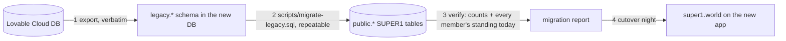

# 08 · Moving the data from Lovable Cloud

The live desk runs on the old repo (`higgywane-bit/healthy-journey-mate`, Lovable Cloud). Its members, tags, memberships, check-ins and activity must arrive in the new database **complete and unchanged**. Nothing in the old database is deleted, ever; it becomes a read-only archive after cutover.

> Old repo rule, still true: "Member, credential, membership, visit, and activity records remain durable … removing pages must never delete those records."

## Plan in one picture

1. **Export everything verbatim.** Prefer a `pg_dump --data-only` of the old project's `public` schema (ask Lovable support for the database connection string if the dashboard doesn't show it). Otherwise export each table as CSV from the Cloud UI. Passwords don't come across, and don't need to: every login in SUPER1 uses an email code.
2. **Load the raw rows into a `legacy` schema** in the new project (`legacy.members`, `legacy.credentials`, `legacy.memberships`, `legacy.check_ins`, `legacy.activity`, `legacy.coaches`, `legacy.user_roles`, `legacy.pt_clients`, `legacy.pt_plans`, `legacy.pt_library_items`, `legacy.workout_logs`, `legacy.daily_feedback`, `legacy.pt_notifications`, `legacy.menu_workspace`). These are never edited. Nothing is lost even if a field has no home in the new model.
3. **Transform** with one idempotent script (`scripts/migrate-legacy.sql`, written in phase 2) that inserts into `public.*` with `legacy_id` set, skipping rows already migrated. It can run many times (dry runs, then the final delta on cutover night).
4. **Verify** (below), then cut over.

## Table mapping

| Old table | New | Notes |
|---|---|---|
| `members` | `members` | Keep the **same uuid** as `id` and in `legacy_id`. Keep `member_no` (insert with `overriding system value`, then move the identity to max + 1). `source` → `created_via` (`admin` → `desk`, Glofox import → `import`). Skip `source = 'demo'` rows (the test member "Pete Hudson"). `archived_at` kept. `nickname`, `email`, `phone`, `line_id`, `notes` kept. `pass_token` and `tags` stay in `legacy.members`. |
| `credentials` | `credentials` | Same code (already normalised). Old `qr` → `qr`; Glofox/physical cards → `tag`. `revoked_at` kept. |
| `memberships` | `memberships` + `sales` | Same uuid. `kind`: `membership` with plan `10-visits` → `visits`; `pt` → `pt`. Plan ids: `1-month` → `1m`, `3-months` → `3m`, `6-months` → `6m`, `12-months` → `12m`, `1-week` → `1w`, `2-weeks` → `2w`, `day-pass` → `day`, `pt-1/3/10/20` → `pt1/3/10/20`, `10-visits` → `10v`. Unknown or custom lengths ("3 Days", "2 Months") → archived plans `legacy-<id>` created first. `starts_on`, `ends_on`, `sessions_*`, `price` kept exactly (the stored end already includes old freezes). `coach` text → `coach_id` by name. `cancelled_at`/`cancel_reason` → `voided_at`/`void_reason`. One `sales` row per membership: `source = import`, `method` from `payment_method` (`qashier` and `glofox` stay as they are), `business_date` = created date in Bangkok. |
| `memberships.frozen_from/until` | `member_pauses` | One pause per frozen membership (member-level), `original_until` = `frozen_until`. Dates on memberships are **not** shifted again. |
| `check_ins` | `checkins` | Same uuid in `legacy_id`. `allowed` → `result`; reasons `no-membership` → `no-plan`, `frozen` → `paused`; `method` → `scan`/`manual`/`app_qr`; `business_date` from `at` in Bangkok; `staff_id` null. |
| `activity` | `activity` | `type` → `kind` as `legacy.<type>`, `message` kept, `staff_name` → `staff_id` (Joy, Jeab, Tee, Bonnie, Fai, Ning), `actor` = `desk` when a staff name is set, else `system`. |
| `coaches` | `coaches` | Aun, Bella, Nicha, Poom (+ Team). Match the seed by name; keep `full_name`. Logins re-linked after invites. |
| `user_roles` (`owner`/`coach`/`client`) | `profiles` | Re-created by invite: Pete admin, Andy owner, coaches coach. Old `client` users become `member` profiles when they first sign in (matched by email). |
| `pt_clients` | `members.user_id` + `leads` | `user_id` → `members.user_id` once that person signs in with the same email. `coach_id` → a `leads` row (`stage = won`, `source = manual`) so the coach still sees them. |
| `pt_plans` (workout) | `programs` + `program_versions` | Convert the doc to `{days:[{name, items:[{exercise_id, name, sets, reps, unit, rest_s, cue}]}]}`; keep the original doc under `body.legacy`. |
| `pt_plans` (diet) | `nutrition_targets` | When the doc has macros; otherwise a `coach_notes` row with the text. |
| `pt_library_items` | `exercises` (`coach_id` set) | Coach's own exercises. |
| `workout_logs` | `workout_logs` + `set_logs` | Expand `entries` into one `set_logs` row per set. |
| `daily_feedback` | `daily_checkins` | Map answer keys (sleep, energy, digestion, water, steps, weight, note); keep the raw answers in `legacy`. |
| `pt_notifications` | not moved | Stays in `legacy` only (it was a delivery queue). |
| `menu_workspace` | `menu_items` macros | Recipes marked `verified` → compute macros for the regular portion from the ingredient table → `kcal`, `protein_g`, `carbs_g`, `fat_g`, `macros_verified_at`. Unverified recipes stay in `legacy` for Pete to finish in the menu manager. |
| Images (menu, coaches, team, brand) | Supabase Storage | Download each asset from the old app's asset URLs (`src/assets/**/*.asset.json` → `url`), upload to the `menu`, `coaches`, `brand` buckets with the same file names. Copies of the main photos are in `design/photos/`. |

## Verify before cutover

Run on the migrated database and save the output as the migration report:

1. **Counts match**: members (minus demo), credentials, memberships, check-ins, activity rows, per table.
2. **Every member's standing today is identical**: for each member, run the old `memberStanding` (old repo `src/lib/membership/access.ts`) on the old rows and `member_card()` on the new; status, cover end and days left must match. List every difference; there should be none except fixed bugs you can explain (queued renewals overlapping a freeze).
3. **Every credential scans the same**: for every active code, old `evaluateAccess` vs new `desk_check_in` in a transaction that is rolled back.
4. **Money**: sum of old `memberships.price` = sum of new `sales.price_thb` with `source = import`.
5. Spot-check 10 members with the desk team.

## Cutover night

1. 22:00 (after close): put the old desk in read-only (the old repo has an admin passcode gate; turn off writes or take it down behind a "moved" page). Announce to staff.
2. Final delta export + `migrate-legacy.sql` (idempotent, only new rows).
3. Verify (steps 1–3 above, quick version).
4. Point `super1.world` at the new Cloudflare Worker. The old app moves to its Lovable URL, read-only, for 30 days.
5. 06:00 open: staff sign in to the new desk, pick who's on shift, scan the first members together.

## Rollback

If something blocks the desk: point `super1.world` back to the old app, which still has all data up to cutover (it was read-only, so nothing diverged). Export any check-ins and sales made on the new desk during the window and replay them into the old system by hand or script. Keep the new database as it is for the retry.

## Never

- Never run `delete`, `truncate`, or `drop` against the old database or the `legacy` schema.
- Never "clean up" old rows during migration. If a row looks wrong, migrate it as it is and flag it in the report.
